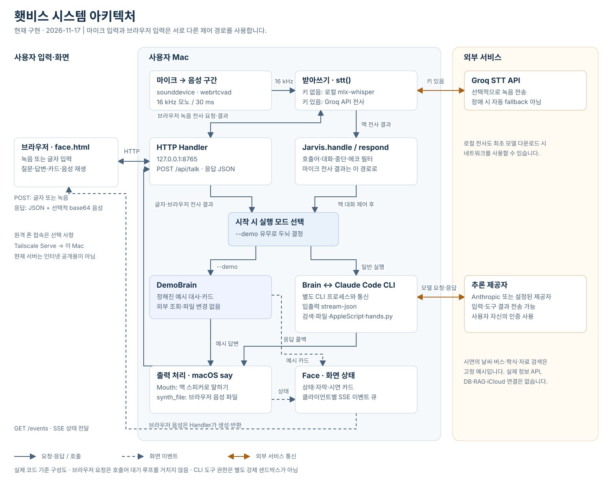
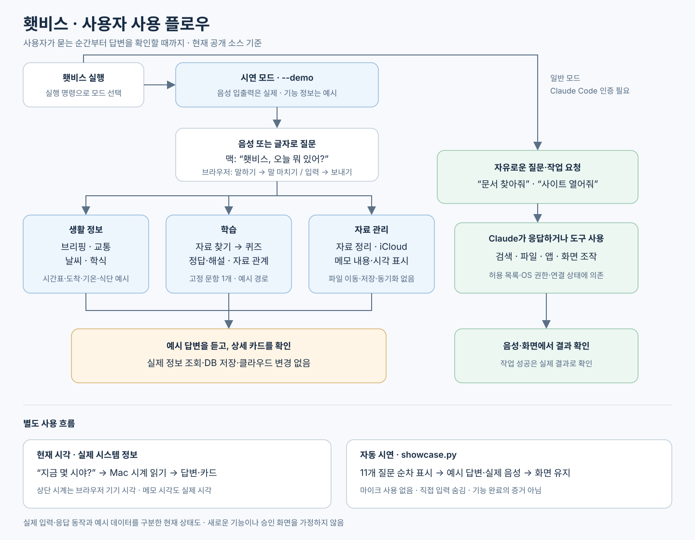

# 횃비스 · Hwatvis

**말로 묻고, 음성으로 듣고, 화면으로 확인하는 macOS 음성 비서 프로토타입.**

마이크와 브라우저 입력을 받아 한국어로 응답합니다. 실제 Claude Code 연결 모드와 정해진 예시를 보여주는 시연 모드를 제공합니다. 팀 이름은 **횃비스**, 내부 실행 파일과 환경 변수는 기존 `jarvis` 이름을 유지합니다.

> 개인·팀의 비공식 프로젝트입니다. 인천대학교 또는 Anthropic의 공식 서비스나 제휴 제품이 아닙니다. 공개본에는 대학 캐릭터 이미지·내장 폰트·이전 시연 영상이 포함되지 않으며, 기본 상태 표시를 사용합니다.

## 지금 할 수 있는 것

| 기능 | 구현 범위 |
|---|---|
| 음성 받아쓰기 | macOS 마이크 또는 브라우저 녹음 → 로컬 `mlx-whisper`. `GROQ_API_KEY`가 있으면 Groq로 전송 |
| 음성 답변 | macOS `say`로 말하기. 브라우저 요청에는 생성한 음성을 반환 |
| 호출·대화 | “횃비스”로 시작, 30초 무응답 시 대기, 이어 말하기·중단·에코 필터 코드 포함 |
| 화면 | 질문·답변·상태·시각·관련 정보 카드. 상태는 SSE로 전달 |
| 실제 두뇌 | 설치·인증된 Claude Code CLI와 JSON 스트림으로 통신 |
| 컴퓨터 조작 | Claude 도구와 `hands.py`의 화면 캡처·클릭·키 입력. OS 권한·도구 허용 범위에 의존 |
| 시연 시나리오 | 브리핑·버스·날씨·학식·자료 찾기·퀴즈·자료 관계·정리·iCloud·메모 |

**시연 시나리오의 정보 조회·자료 검색·분류·DB·iCloud·메모 저장은 예시입니다.** 실제 외부 API 연결, 강의 파일 열기, 파일 이동, DB 저장 또는 동기화를 수행하지 않습니다. 현재 시각은 실제 시스템 시각을 사용합니다. 일반 모드의 Claude 도구 사용과 시연 모드의 예시 기능을 구분해야 합니다.

## 시작하기

Apple Silicon Mac, Python 3.10 이상을 권장합니다. 로컬 받아쓰기는 MLX 지원 환경과 모델 다운로드가 필요합니다. 브라우저 녹음 형식을 처리할 때는 `ffmpeg`가 필요할 수 있고, `hands.py` 화면 캡처도 `ffmpeg`를 사용합니다.

```bash
git clone https://github.com/kdh001/hwatvis.git
cd hwatvis
python3 -m venv .venv
.venv/bin/python -m pip install -r requirements.txt
```

### 먼저 시연 모드로 확인

```bash
# Claude 없이 실행. 브라우저에서 글자 입력 또는 마이크 버튼 사용
.venv/bin/python jarvis.py --demo --text
```

`http://localhost:8765`를 열고 “오늘 뭐 있어?”, “자료 기반 퀴즈 내줘”, “정답 알려줘”를 입력합니다. 이 명령은 자동으로 브라우저를 열지 않습니다. 글자 입력만으로도 예시 응답을 확인할 수 있습니다. 마이크를 쓰면 실제 받아쓰기 경로를 사용하므로, 첫 실행 시 모델 다운로드 또는 설정된 Groq 호출이 발생할 수 있습니다.

```bash
# 맥 마이크로 듣고 맥 스피커로 말하는 시연
.venv/bin/python jarvis.py --demo

# 마이크 없이 정해진 질문·답변을 순서대로 재생
.venv/bin/python showcase.py
```

자동 시연은 `http://localhost:8765`에서 확인합니다. 포트는 실행당 한 프로세스만 사용하세요. 종료는 터미널에서 `Ctrl+C`입니다.

### Claude 연결 모드

[Claude Code 설치·인증](https://code.claude.com/docs/en/overview)을 사용자가 직접 완료해야 합니다. CLI·모델·인증 방식은 제공자의 현재 지원 범위를 따릅니다.

```bash
claude --version
.venv/bin/python jarvis.py --text

# 맥 마이크·스피커 사용
.venv/bin/python jarvis.py

# 이어폰: 말하는 동안 새 발화로 중단
JARVIS_HEADPHONES=1 .venv/bin/python jarvis.py
```

마이크 사용 시 실행하는 앱에 마이크 권한이 필요합니다. 화면 조작을 사용할 때만 화면 기록·손쉬운 사용 권한을 별도로 부여합니다. macOS 한국어 음성이 없으면 시스템 설정에서 설치하거나 `say -v '?'`로 사용 가능한 음성을 확인하세요.

## 시스템 아키텍처

사용자 Mac, 브라우저, 외부 서비스의 경계와 입력·응답 경로를 표시했습니다. 일반 Claude 모드와 예시 시연 모드를 구분합니다.



[구성요소·통신 경로·공식 조사 자료](docs/architecture.md) · [Mermaid 원본](docs/diagrams/system-architecture.mmd)

## 기능별 사용자 플로우

질문을 시작하는 방법부터 각 기능의 화면·음성 결과까지, 실제 동작과 예시 응답을 나눠 정리했습니다.



[입력 방식과 기능별 상세 플로우](docs/user-flows.md) · [개요 Mermaid 원본](docs/diagrams/user-flow-overview.mmd)

## 설정

| 환경 변수 | 기본값 | 의미 |
|---|---|---|
| `JARVIS_VOICE` | `Yuna` | macOS 음성 |
| `JARVIS_MODEL` | `sonnet` | 일반 모드 Claude 모델 별칭 |
| `JARVIS_PORT` | `8765` | 로컬 HTTP 포트 |
| `JARVIS_KEY` | 빈값 | URL 쿼리의 단순 공유 키. 완전한 인증 시스템은 아님 |
| `JARVIS_HEADPHONES` | 미설정 | `1`이면 이어폰 중단 방식 |
| `JARVIS_END_SIL` | `0.8` | 말 끝 무음 판정, 초 |
| `GROQ_API_KEY` | 미설정 | 설정하면 녹음을 Groq API에 전송 |

키는 환경 변수로만 제공하고 저장소에 넣지 마세요. 로컬 받아쓰기도 최초 모델 다운로드는 네트워크를 사용합니다. Claude Code·Groq·Tailscale의 비용·쿼터·이용 조건은 각 제공자 정책을 따르며 무료·무제한을 보장하지 않습니다.

폰 접속은 선택 사항입니다. [Tailscale Serve](https://tailscale.com/docs/reference/tailscale-cli/serve)로 로컬 포트를 같은 tailnet에 제공할 수 있습니다. 이 저장소는 Serve 설정을 자동 실행하지 않습니다. **이 서버를 인터넷에 직접 공개하거나 Funnel로 공개하지 마세요.** 다중 사용자 서비스용 인증·요청 검증·호출 제한을 갖춘 서버가 아닙니다.

## 권한·개인정보·한계

- 일반 모드는 입력·도구 결과가 모델 제공자에게 전송될 수 있습니다. 화면 캡처나 파일 읽기에 개인정보가 포함되지 않도록 실행 범위를 확인해야 합니다. Groq 경로는 녹음을 외부로 전송합니다.
- `persona.md`의 “실행 전 승인”은 모델 지시이며, 별도 승인 UI나 강제 실행 게이트가 아닙니다. `permissions.json`의 AppleScript·화면 조작 권한이 넓으므로 안전한 샌드박스로 간주하면 안 됩니다.
- 서버는 loopback에 바인딩되지만, 키 기본값은 비어 있습니다. 키를 URL에 넣으면 브라우저 기록 등에 남을 수 있습니다.
- 음성 입력·인식된 문장은 터미널과 Claude 자체 세션 기록에 남을 수 있습니다. `autostart.sh`는 일반 모드를 로그인 시 실행하고 프로젝트 폴더에 로그를 씁니다. 공개본의 시작 안내는 수동 시연 실행을 기준으로 합니다.
- 스피커 에코 필터와 끼어들기는 휴리스틱입니다. 실제 사람 발화·소음·폰 실기기·장시간 동시 입력의 안정성은 보장하지 않습니다.

## 파일 안내

| 파일 | 역할 |
|---|---|
| `jarvis.py` | 받아쓰기·대화·Claude·음성·HTTP/SSE |
| `face.html` | 브라우저 UI·녹음·재생 |
| `demo_brain.py` / `spoken_responses.json` | 시연 질의 분기·예시 대사 |
| `showcase.py` | 마이크 없이 순차 자동 시연 |
| `hands.py` | Quartz 화면 조작·캡처 |
| `persona.md` / `permissions.json` | 모델 지시·도구 허용 목록 |
| `selftest.py` | 기존 규칙·음성 흐름 검사 |
| `autostart.sh` | 선택적 launchd 등록·해제 |

## 검증

공개 준비 시 Python 문법, 기존 quick 검사, JavaScript 문법, 시연 HTTP 질의·카드·무음 응답, 배포 대상의 비밀정보 패턴·제외 자산을 확인했습니다. 결과와 검증하지 않은 범위는 [공개 검토 기록](docs/publication-review.md)을 참고하세요.

```bash
.venv/bin/python selftest.py --quick
```

`selftest.py` 전체 실행은 실제 받아쓰기·Claude 호출을 포함할 수 있습니다. 단순 설치 확인에는 `--quick`을 사용하세요.

## 출처와 이용 권리

초기 아이디어는 하루 AI 「나만의 자비스 만들기」 [1편](https://youtu.be/AjYni77zVEM)·[2편](https://youtu.be/_iNGkJwbua8)·[3편](https://youtu.be/IDTDyMCLQWo)·[4편](https://youtu.be/uvMQW195L7s) 및 관련 프롬프트 자료를 참고했습니다. 원본 영상·자막·프롬프트 문서는 이 저장소에 배포하지 않습니다. 학습 참고 사실이 제3자 저작물의 재배포 권한을 뜻하지는 않습니다.

범용 오픈소스 라이선스는 아직 부여하지 않았습니다. GitHub 공개는 MIT 등 포괄적인 재사용 허락과 다릅니다. 제3자 구성요소는 각자의 이용 조건을 따릅니다. [공개 제외 자산·검토 한계](docs/publication-review.md)를 확인하세요.
