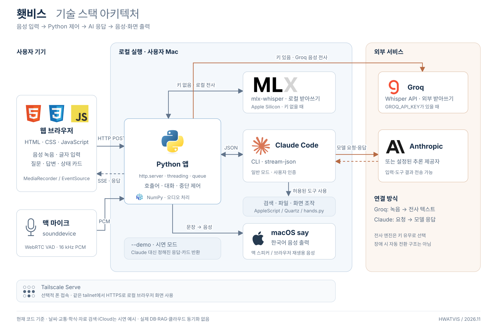

# 횃비스 아키텍처

확인일: 2026-11-17. 현재 공개 소스 기준입니다.

[벡터 도식 크게 보기](diagrams/tech-stack-architecture.svg) · [PNG 이미지](diagrams/tech-stack-architecture.png) · [수정용 생성 코드](diagrams/build-tech-stack.py) · [기능별 사용자 플로우](user-flows.md)

## 시각 레퍼런스와 로고

기술 로고를 노드로 배치하고 실행 환경을 묶는 [Diagrams의 Clustered Web Services·Stateful Architecture 예제](https://diagrams.mingrammer.com/docs/getting-started/examples)를 참고했습니다. 예제의 AWS·Kubernetes 구성은 가져오지 않고 횃비스가 실제 사용하는 기술로 새로 그렸습니다.

웹 표준·Python·NumPy는 Devicon, Claude·Anthropic·Apple·Tailscale은 Simple Icons, Groq는 Lobe Icons, MLX는 Apple MLX 저장소의 벡터 로고를 사용합니다. [고정 커밋·로고 원본·라이선스](diagrams/assets/tech-logos/README.md)를 함께 보관했습니다. 로고는 기술 식별용이며 제휴나 공식 서비스임을 뜻하지 않습니다.

이 그림은 기술 스택과 주된 통신을 보여주는 개요입니다. 함수별 상세 분기는 [이전 상세 실행 경로](diagrams/system-architecture.svg)와 [Mermaid 원본](diagrams/system-architecture.mmd)을 참고하세요. Python 노드는 브라우저 Handler와 맥 마이크의 대화 제어를 요약한 것이며 두 입력 경로가 같은 루프를 통과한다는 뜻은 아닙니다.

## 경계와 구성

브라우저, Python 프로세스, Claude Code 자식 프로세스, 외부 모델 제공자를 구분하고 통신 방식을 표시했습니다. 구성요소의 책임·기술·통신 관계를 설명하는 [C4 container diagram 지침](https://c4model.com/diagrams/container)을 참고한 구성도입니다. Python 내부 클래스도 함께 표시한 도식이므로 엄밀한 C4 레벨 2 표준 도식이라고 주장하지 않습니다. 위 로고형 그림은 기술 스택을, 별도의 상세 도식은 세부 노드·데이터 경로를 보여줍니다.

| 구성요소 | 실제 구현 |
|---|---|
| 브라우저 | `face.html`: MediaRecorder, POST `/api/talk`, EventSource `/events`, Audio 재생 |
| 마이크 | `mic_frames()` → `segments()`: sounddevice와 WebRTC VAD, 16 kHz 모노·30 ms |
| 받아쓰기 | `stt()`: 환경 변수의 키가 있으면 Groq, 없으면 로컬 MLX. 자동 장애 fallback은 아님 |
| 대화 제어 | `Jarvis`: 호출어·무음 타임아웃·이어 말하기·중단·에코 비교 |
| 일반 두뇌 | `Brain`: CLI 자식 프로세스·JSON 스트림·문장 단위 응답·도구 사용 이벤트 |
| 시연 두뇌 | `DemoBrain`: 질의 패턴과 예시 대사·카드. 외부 정보 연결·저장 없음 |
| 말하기 | `Mouth`의 `say` 프로세스·큐, 브라우저용 `synth_file()` |
| 화면 상태 | `Face.send()` → 각 SSE 클라이언트 큐 |
| PC 조작 | Claude 도구 허용 목록과 `hands.py`; macOS 권한에 의존 |

## 입력에 따른 실행 차이

1. **맥 마이크:** 음성 구간 → STT → 호출어·대화 제어 → 두뇌 → 문장 큐 → 맥 스피커. 상태·자막은 SSE로 전달합니다.
2. **브라우저:** 녹음 또는 글자 → HTTP Handler → 필요 시 STT → 두뇌 → 답변 JSON. 요청의 `audio` 여부 등에 따라 음성 파일도 반환하며 브라우저가 재생합니다. 마이크의 호출어 대기 루프를 통과하지 않습니다.
3. **자동 시연:** `showcase.py`가 예시 질의를 순서대로 넣고 `DemoBrain.answer()`·`say`·화면 이벤트를 호출합니다. 실제 검색이나 파일 작업의 실행 증거가 아닙니다.

따라서 모든 입력이 하나의 대화 제어 함수로 통합된 구조가 아닙니다. 원격 브라우저의 음성 응답과 맥 마이크의 음성 큐도 별도 경로입니다. 브라우저의 녹음은 `Handler.do_POST()`가 `stt()`를 호출한 뒤 그 결과를 다시 받아 두뇌에 직접 전달합니다. 이 결과가 `Jarvis.handle()`로 들어가는 것은 아닙니다. 전사 엔진은 키 유무로 선택하며 Groq 오류 때 로컬 엔진으로 자동 재시도하지 않습니다. 현재 구조를 그대로 문서화했으며 대규모 리팩터링은 하지 않았습니다.

## 외부 통신과 데이터

- `GROQ_API_KEY` 설정 시 녹음이 Groq로 전송됩니다. 없으면 MLX 모델로 로컬 인식합니다. 모델 파일의 최초 다운로드는 별도 네트워크 사용입니다.
- 일반 모드의 입력과 도구 결과는 Claude Code가 구성한 추론 제공자에게 전송될 수 있습니다. 브라우저 UI가 Claude API에 직접 접속하는 구조는 아닙니다.
- 예시 파일 경로·교통·날씨·식단·수업 자료는 `DemoBrain`의 고정 예시입니다. PostgreSQL, Redis, 벡터 DB, RAG 서버, 실제 iCloud 동기화는 없습니다.
- `Tailscale Serve`는 사용자가 선택적으로 설정하는 프록시입니다. 이 앱의 내장 인증 기능이 아니며 공개 인터넷 배포를 의미하지 않습니다.

## 웹 조사 자료

아래는 기술의 공식 설명을 확인한 자료입니다. 프로젝트의 구현 여부는 위 소스 대응표로 별도 확인했습니다.

- [Claude Code 비대화형 실행·스트리밍](https://code.claude.com/docs/en/headless): `-p`와 구조화된 스트림 출력.
- [Claude Code 법률·이용 조건](https://code.claude.com/docs/en/legal-and-compliance): 사용자별 인증·제품 제공 시 조건. 개인 로컬 사용과 호스팅·재판매를 구분해야 합니다.
- [Groq Speech to Text](https://console.groq.com/docs/speech-to-text): 음성 전사 API.
- [Apple MLX Whisper 예제](https://github.com/ml-explore/mlx-examples/tree/main/whisper): MLX 기반 로컬 전사 구현.
- [Tailscale Serve](https://tailscale.com/docs/reference/tailscale-cli/serve): tailnet 내 로컬 서비스 제공.
- [C4 container diagram](https://c4model.com/diagrams/container): 시스템 경계·책임·통신 표시 방식.
