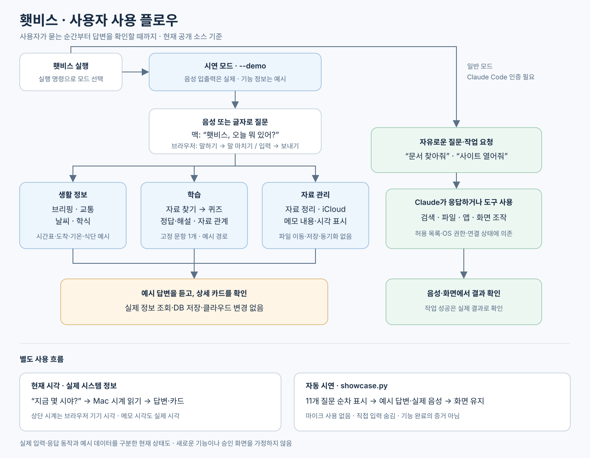
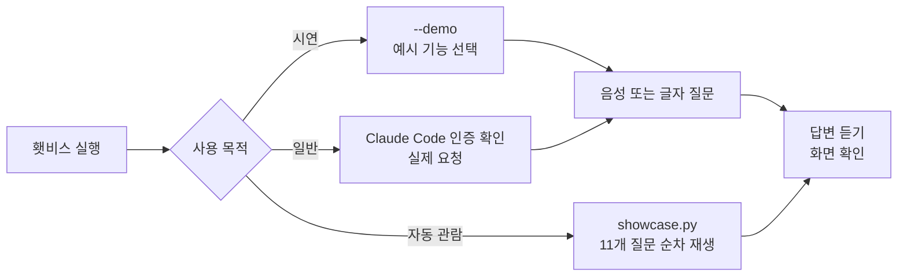
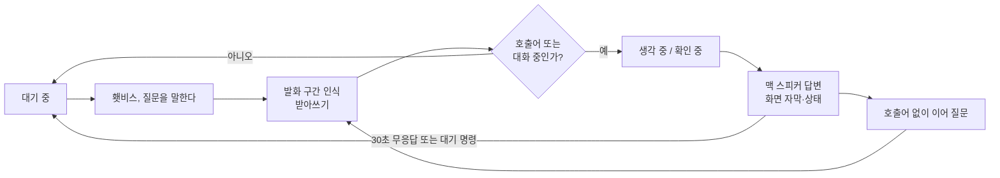
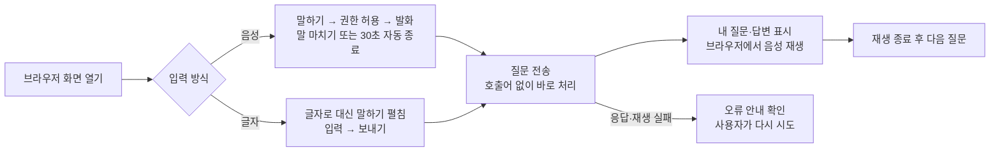
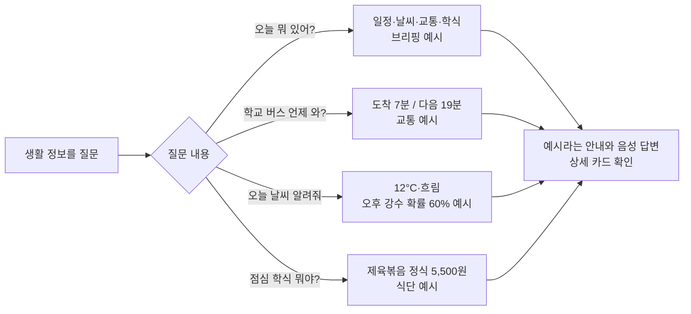
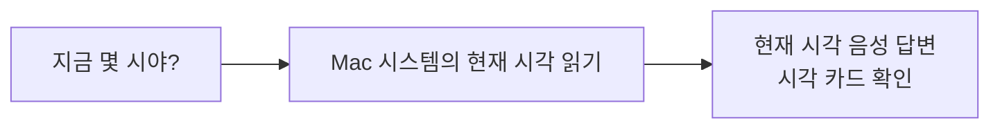
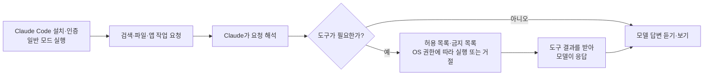
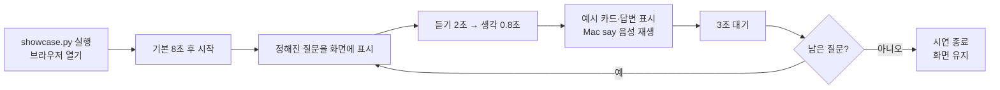

# 횃비스 기능별 사용자 플로우

현재 공개 소스 기준 · 확인일 2026-11-17

**사용자가 무엇을 입력하고, 무엇을 듣고 보며, 실제로 무엇이 바뀌는지**를 정리했습니다. 이 문서의 생활·학습·자료 관리 기능은 `--demo` 시연 모드를 기준으로 합니다. 일반 Claude 연결 모드는 별도 실행 경로입니다.



[PNG 이미지](diagrams/user-flow-overview.png) · [개요 Mermaid 원본](diagrams/user-flow-overview.mmd) · [시스템 아키텍처](architecture.md) · [설치·실행 안내](../README.md#시작하기)

## 1. 실행과 첫 질문

| 사용 목적 | 실행 | 사용자가 다음에 할 일 | 실제 범위 |
|---|---|---|---|
| 글자·브라우저 음성으로 시연 | `.venv/bin/python jarvis.py --demo --text` | `http://localhost:8765`를 직접 열고 글자 입력 또는 말하기 버튼 사용 | 예시 응답. 브라우저 녹음 시 실제 받아쓰기 사용 |
| 맥 마이크로 시연 | `.venv/bin/python jarvis.py --demo` | “횃비스, 오늘 뭐 있어?”라고 말하기 | 실제 받아쓰기·음성 출력 + 예시 정보 |
| 실제 Claude에 요청 | `.venv/bin/python jarvis.py --text` 또는 `jarvis.py` | 글자·음성으로 질문. Claude Code 설치·인증 필요 | 모델 응답과 허용된 도구 사용. 결과는 요청·권한·연결 상태에 의존 |
| 질문을 순서대로 자동 재생 | `.venv/bin/python showcase.py` | 브라우저를 직접 열어 관람 | 마이크 없이 정해진 11개 질문·예시 답변과 실제 TTS 재생 |



모드를 바꾸는 화면 버튼은 없습니다. 실행 명령으로 결정합니다. `--text`는 **맥 마이크 루프를 끄는 옵션**이며, 브라우저 마이크 사용까지 금지하는 옵션은 아닙니다.

## 2. 질문하는 방법

### 맥 마이크



- “횃비스”만 부르면 “네?”라고 응답한 뒤 질문을 기다립니다. 기존 “자비스” 호출어도 인식합니다.
- 말 끝 무음의 기본값은 0.8초입니다. “…그리고”처럼 끝난 문장은 1.5초 더 기다려 다음 발화를 합칩니다.
- 생각 중 이어 말하면 진행 중 응답을 중단하고 앞 질문과 합쳐 처리합니다. 말하는 중에는 스피커 모드에서 호출어로, 이어폰 모드에서는 새 발화로 중단을 시도합니다.
- “횃비스 대기”, “그만 들어”, “잘 자” 같은 짧은 명령은 대기로 돌립니다. 에코 필터와 중단은 휴리스틱이며 실제 환경에서 완벽하게 동작한다고 보장하지 않습니다.
- 받아쓰기 실패는 터미널에 기록하고 그 발화를 건너뜁니다. 실패한 음성을 자동으로 재전송하는 사용자 플로우는 없습니다.

### 브라우저 음성·글자



브라우저 음성은 버튼을 눌러 시작하고 다시 눌러 마칩니다. 버튼을 누르고 있는 동안만 녹음하는 방식이 아닙니다. 맥 마이크 모드에서는 브라우저 말하기 버튼을 숨기고, 글자 입력은 남깁니다. 서버 연결이 끊기면 말하기 버튼이 비활성화되며 연결 오류를 표시합니다.

한 브라우저에서는 요청·음성 재생 중 새 전송을 막습니다. 브라우저 입력은 맥의 호출어·30초 대화 대기 루프를 거치지 않으므로, 모든 입력 방식의 중단 동작이 같지는 않습니다. 터미널 글자 입력은 호출어 없이 새 질문을 보내고 기존 음성·응답을 중단하도록 구현돼 있습니다.

## 3. 생활 정보: 브리핑·교통·날씨·학식



| 기능 | 질문 예 | 화면에 보이는 결과 | 실제로 조회하는 것 |
|---|---|---|---|
| 오늘 브리핑 | “오늘 뭐 있어?” | 10:00 전공 수업, 15:00 팀 미팅·날씨·버스·학식 카드 | 없음. 실제 캘린더·일정 조회 아님 |
| 교통·통학 | “학교 버스 언제 와?” | 학교 방향, 7분·19분 후 도착, 예시 경로 | 없음. 정류소 위치·실시간 버스 API 조회 아님 |
| 날씨 | “오늘 날씨 알려줘” | 12°C·흐림·오후 강수 확률 60% | 없음. 기상·위치 API 조회 아님 |
| 학식 | “점심 학식 뭐야?” | 점심 제육볶음 정식 5,500원, 저녁 순두부찌개 5,000원 | 없음. 당일 식단·가격 조회 아님 |

수치는 시연 파일에 정해져 있습니다. “목적지를 말씀해 주세요”라는 교통 대사가 있어도 실제 경로 탐색·목적지 입력 단계가 구현된 것은 아닙니다. 질문 키워드가 맞지 않으면 기능을 안내하는 기본 예시 응답으로 돌아갑니다.

## 4. 학습: 자료 찾기·퀴즈·자료 관계

```mermaid
flowchart LR
  find["수업 자료 찾아줘"] --> files["슬라이드·설명 자료<br/>경로 예시 확인"]
  files --> branch{"이어 할 질문"}
  branch -->|"자료 기반 퀴즈 내줘"| quiz["입력 3개인 논리 회로<br/>입력 조합 수는?"]
  branch -->|"자료 관계 보여줘"| graph["강의 → 개념 → 연습·복습<br/>관계 카드 예시"]
  quiz --> answer{"사용자 답변"}
  answer -->|"8 / 여덟 / 팔"| correct["정답 예시<br/>2³ = 8"]
  answer -->|"정답 알려줘 / 모르겠어"| explain["해설 예시<br/>n개 입력 → 2ⁿ개 조합"]
  answer -->|"그 밖의 입력"| route["입력 키워드에 따라<br/>다른 예시 또는 기능 안내"]
```

| 기능 | 사용자 순서 | 결과와 한계 |
|---|---|---|
| 자료 찾기 | “수업 자료 찾아줘” → 경로 카드 확인 | 디지털집적회로 10주차 슬라이드·설명 자료의 **예시 경로**. 디스크 검색이나 파일 열기 없음 |
| 퀴즈 | “자료 기반 퀴즈 내줘” → 답 말하기 → 답변 확인 | 고정 문항 1개. 실제 강의 파일에서 문항을 생성하지 않음 |
| 정답·모름 | 퀴즈를 먼저 요청 → “정답 알려줘” 또는 “모르겠어” | 2³ = 8 해설. 오답 이유를 요구하지 않음 |
| 자료 관계 | “자료 관계 보여줘” → 관련 항목 카드 확인 | 강의→논리 회로→진리표→입력 조합→연습·복습의 예시. 실제 지식 그래프 조회나 그래프 탐색 UI 아님 |

퀴즈는 `DemoBrain.last_topic`에 상태를 보관합니다. 퀴즈를 시작하기 전 “정답 알려줘”에는 전용 해설이 나오지 않습니다. 올바른 답을 판별하는 패턴은 `8`, `여덟`, `팔`이며 범용 채점기는 아닙니다. 그 밖의 답에 대해 일관된 오답 판정·재출제·점수 기록은 구현돼 있지 않습니다. 이 상태는 서버 프로세스의 공유 객체에 있으며 사용자별 로그인·개별 학습 기록으로 분리되지 않습니다.

## 5. 자료 관리: 정리·iCloud·메모

```mermaid
flowchart LR
  q["자료 관리 요청"] --> topic{"요청 내용"}
  topic -->|"새 자료 정리해줘"| organize["자료 2개·분류·검색 연결<br/>예시 카드"]
  topic -->|"아이클라우드 자료 보여줘"| cloud["원본 → 설명 자료<br/>연결 예시 카드"]
  topic -->|"메모: 복습하기"| memo["입력 내용과 실제 작성 시각<br/>화면 카드"]
  organize --> view["화면·음성으로 확인"]
  cloud --> view
  memo --> view
  view --> end["시연 종료<br/>파일·DB·클라우드 변경 없음"]
```

| 기능 | 사용자 입력 | 표시 내용 | 하지 않는 일 |
|---|---|---|---|
| 자료 정리·DB | “새 자료 정리해줘” | 수업 슬라이드·수업 필기 2개, 디지털집적회로/10주차 분류, 검색 연결 예시 | 실제 파일 분류·이름 변경·이동·DB 쓰기 |
| iCloud | “아이클라우드 자료 보여줘” | iCloud/공부/디지털집적회로 원본→설명 자료 예시 | iCloud 상태 조회·계정 연결·다운로드·동기화 |
| 메모 | “메모: 다음 수업 전에 복습하기” | 입력한 내용과 실제 시스템 작성 시각, 파일 미생성 안내 | 메모 파일 생성·장기 저장·동기화 |

메모가 화면에 남는 것은 파일 저장 완료를 뜻하지 않습니다. 서버 재시작 뒤 조회할 수 있는 메모함·저장 성공 화면·삭제 기능은 없습니다. 시연 데이터 자체는 외부 파일을 변경하지 않지만 입력한 문장은 터미널 로그 등 실행 환경의 기록에 남을 수 있습니다.

## 6. 현재 시각



현재 시각 질문은 `datetime.now().astimezone()`을 사용하므로 고정 예시가 아닙니다. 화면 상단 시계는 브라우저가 실행되는 기기의 시각을 표시합니다. 폰에서 보면 두 기기의 시계·시간대 설정 차이로 상단 시계와 Mac의 답변이 다를 수 있습니다.

## 7. 일반 모드: Claude에 실제 작업 요청



질문 예는 “이 폴더에서 문서 찾아줘”, “이 사이트 열어줘”, “지금 화면을 확인해 줘”입니다. 이는 시연 패턴을 실제 기능으로 바꾸는 스위치가 아니라 Claude의 일반 도구 경로입니다. 작업 성공 여부는 실제 결과로 확인해야 하며, 시연 모드의 생활·학습 카드가 일반 모드에도 그대로 제공되는 것은 아닙니다.

`persona.md`에는 결제·전송·삭제·보안 변경 전 승인을 묻도록 적혀 있습니다. 그러나 별도 승인 버튼이나 실행을 막는 승인 상태 기계는 없습니다. 문서의 플로우에 “승인 완료 → 실행” 게이트를 구현된 기능처럼 그리지 않았습니다. 넓은 AppleScript·화면 조작 권한이 있으므로 `permissions.json`을 강한 격리 장치로 간주하면 안 됩니다.

## 8. 자동 시연 관람



순서는 브리핑 → 교통 → 날씨 → 학식 → 자료 검색 → 퀴즈 → 해설 → 자료 관계 → 정리 → iCloud → 메모의 11개입니다. `--scene`으로 질문 하나만 지정할 수도 있습니다. 자동 시연 중에는 브라우저 말하기 버튼과 글자 입력을 숨기며, 실제 마이크·검색·파일 작업이 수행되는 장면이 아닙니다. 종료는 터미널에서 `Ctrl+C`입니다.

## 소스 대응과 검증 범위

| 사용 흐름 | 확인한 코드 |
|---|---|
| 시작·모드 선택 | `jarvis.py`: `main()`, `Jarvis.__init__()` |
| 맥 마이크·대화 | `mic_frames()`, `segments()`, `Jarvis.ear/handle/run/respond()` |
| 브라우저 음성·글자·오류 | `face.html`: 말하기 버튼, `ask()`, form submit, SSE handlers; `Handler.do_POST()` |
| 시연 기능·퀴즈 상태 | `demo_brain.py`: `_answer()`, `last_topic`; `spoken_responses.json` |
| 현재 시각·메모 시각 | `DemoBrain._answer()`; `face.html`: `clock()` |
| 일반 Claude·도구 | `Brain.ask/interrupt()`, `permissions.json`, `persona.md` |
| 자동 시연 | `showcase.py`: `scenes`, `play()` |

기능별 예시 질의·카드 제목·퀴즈 정답/모름·실제 현재 시각 분기는 직접 확인했습니다. 문서의 흐름과 현재 코드의 대응을 검수했으며, 실제 사람의 마이크·스피커 환경, 폰 실기기, 일반 Claude 도구의 실행 성공을 새로 검증한 문서는 아닙니다.
